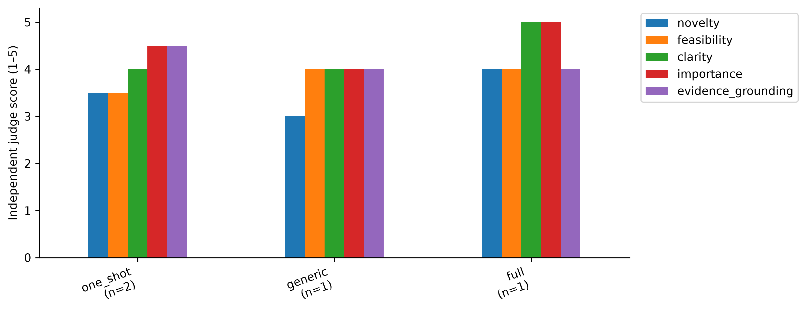
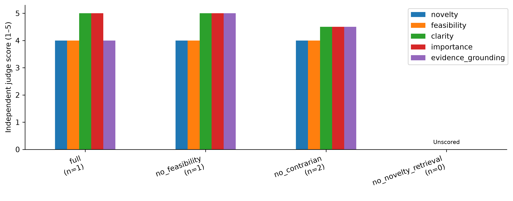
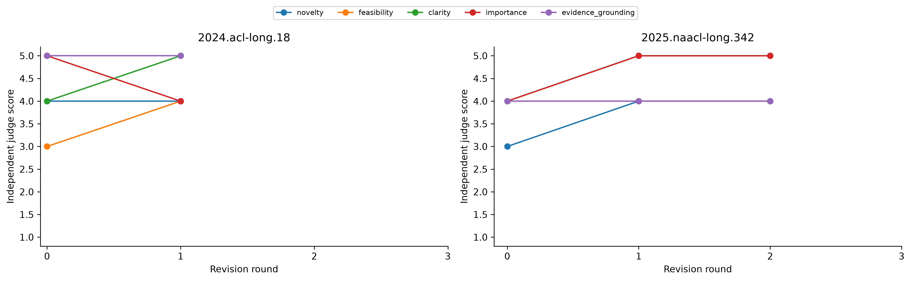
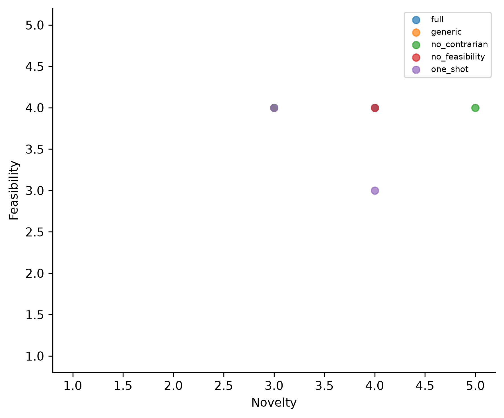
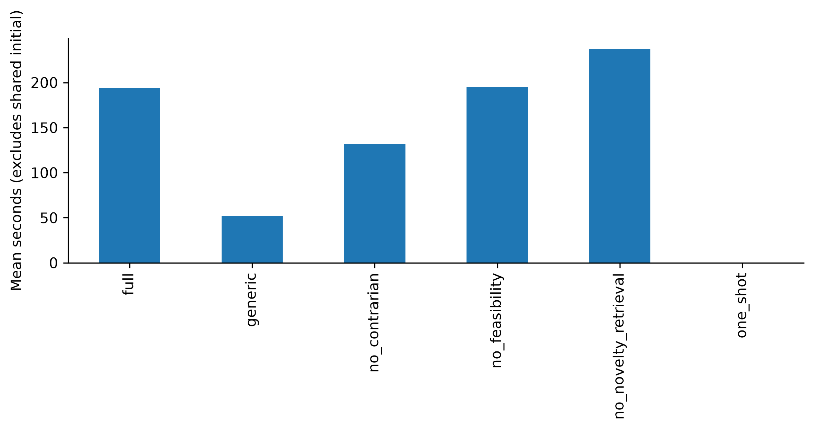

# Observed experiment results

Generated from saved live Gemini runs and independent judgments.

Independent seeds with final scores: 2. Valid score rows: 17; missing/failed rows: 6.

## Final mean scores by configuration

| Configuration | Seeds | Novelty | Feasibility | Clarity | Importance | Grounding |
|---|---:|---:|---:|---:|---:|---:|
| one_shot | 2 | 3.50 | 3.50 | 4.00 | 4.50 | 4.50 |
| generic | 1 | 3.00 | 4.00 | 4.00 | 4.00 | 4.00 |
| full | 1 | 4.00 | 4.00 | 5.00 | 5.00 | 4.00 |
| no_feasibility | 1 | 4.00 | 4.00 | 5.00 | 5.00 | 5.00 |
| no_contrarian | 2 | 4.00 | 4.00 | 4.50 | 4.50 | 4.50 |
| no_novelty_retrieval | 0 | unscored | unscored | unscored | unscored | unscored |

Variation and individual scores are preserved in summary.csv and evaluation/scores.csv. Descriptive paired changes are in paired_comparisons.csv.

## Interpretation limits

Same-model judge; purposive sample; abstract-only retrieval; unequal natural call budgets. These scores concern proposals and do not establish executed scientific success. Check incomplete runs, failures, and configuration coverage before claiming an efficacy comparison. Different valid seed counts prevent interpreting unmatched group means as treatment effects. Iteration plots show each seed separately, with gaps for missing judgments.

## Figures

