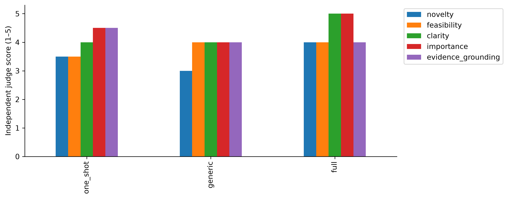
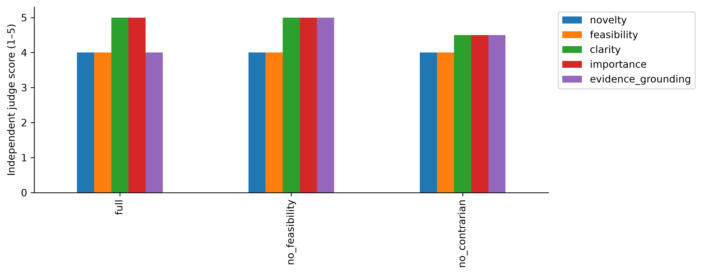
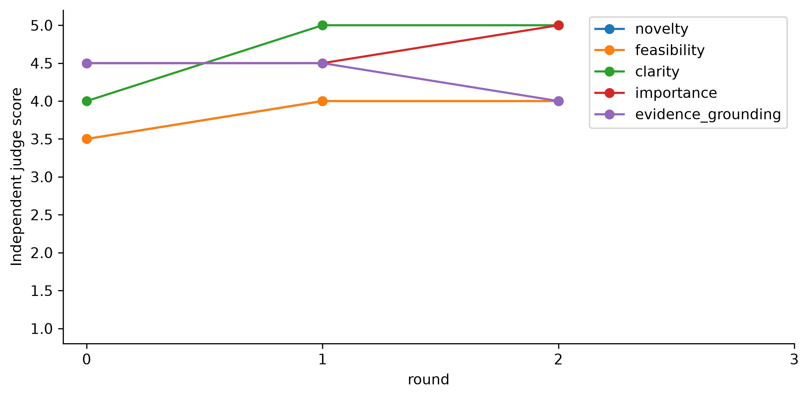
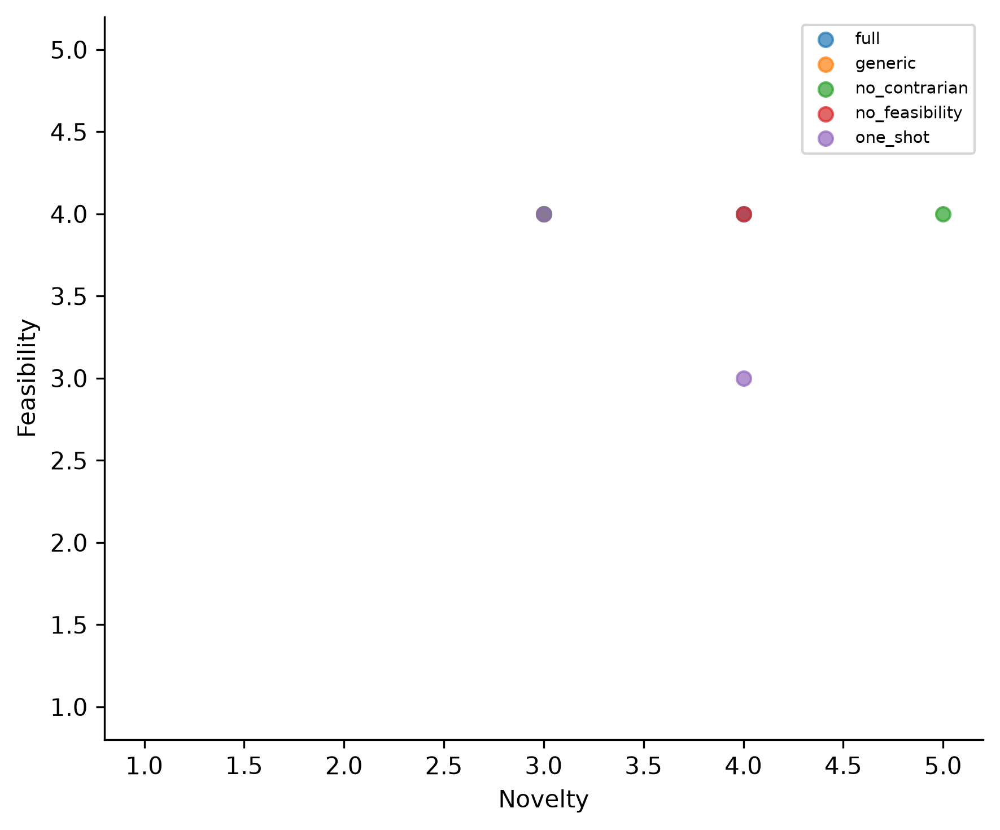
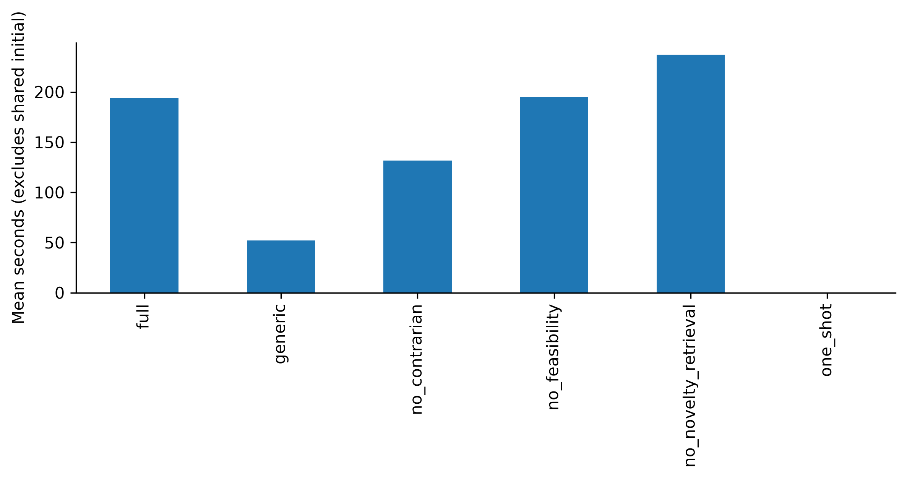

# Observed experiment results

Generated from saved live Gemini runs and independent judgments.

Independent seeds with final scores: 2. Valid score rows: 17; missing/failed rows: 6.

## Final mean scores by configuration

| Configuration | Seeds | Novelty | Feasibility | Clarity | Importance | Grounding |
|---|---:|---:|---:|---:|---:|---:|
| full | 1 | 4.00 | 4.00 | 5.00 | 5.00 | 4.00 |
| generic | 1 | 3.00 | 4.00 | 4.00 | 4.00 | 4.00 |
| no_contrarian | 2 | 4.00 | 4.00 | 4.50 | 4.50 | 4.50 |
| no_feasibility | 1 | 4.00 | 4.00 | 5.00 | 5.00 | 5.00 |
| one_shot | 2 | 3.50 | 3.50 | 4.00 | 4.50 | 4.50 |

Variation and individual scores are preserved in summary.csv and evaluation/scores.csv. Descriptive paired changes are in paired_comparisons.csv.

## Interpretation limits

Same-model judge; purposive sample; abstract-only retrieval; unequal natural call budgets. These scores concern proposals and do not establish executed scientific success. Check incomplete runs, failures, and configuration coverage before claiming an efficacy comparison.

## Figures

